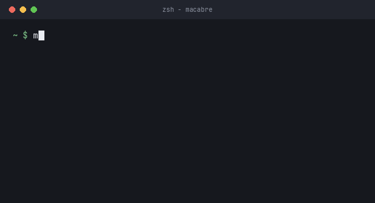

# learning-rust

Rust exercises and mini-projects, built one concept at a time.

## Purpose

A public record of learning Rust: small tools, the mistakes made along the way, and the habits that stuck. Each project focuses on a specific area of the language and the surrounding systems discipline — ownership, unsafe boundaries, error handling, testing.

## Projects

| Project | Description | Focus |
|---|---|---|
| [macabre](macabre/) | Change and restore network interface MAC addresses on Linux | ioctls, `unsafe` discipline, a zero-dependency JSON store, argument parsing without clap |

Each project's README covers usage, design, and testing.

## Reading macabre

Start with `src/main.rs` (the binary and its exit-code policy), then `src/mac.rs` (the address type — pure and fully tested), then `src/iface.rs` (the Linux ioctl layer). Each module has one responsibility, and tests live next to the code they cover.

## Conventions

- **Testing** — unit tests live in `#[cfg(test)]` modules beside the code; CLI contract tests live in `tests/`. CI runs `cargo build`, `cargo test`, `cargo clippy -D warnings`, and `cargo fmt --check` on every push.
- **Error handling** — library code returns `io::Result`; only `main` assigns exit codes (2 for usage errors, 1 for runtime failures). No panics on expected failure paths.
- **Unsafe** — macabre has five `unsafe` blocks (socket creation, two ioctls, two sockaddr transmutes). Each wraps a libc call with a checked return value; no `unsafe` construct leaks past the `iface` module boundary.
- **Toolchain** — stable Rust only. No nightly features.

## Roadmap

Planned next projects, in order:

1. A small shell (fork/exec/pipes)
2. A bump allocator
3. A modal text editor

Each reuses something macabre introduced: ioctls, unsafe discipline, or dependency-free parsing.

## Contributing

Corrections, tests, and docs improvements are welcome — see [CONTRIBUTING.md](CONTRIBUTING.md). I aim to respond to issues and PRs within 24 hours.

## License

MIT — see [LICENSE](LICENSE).
